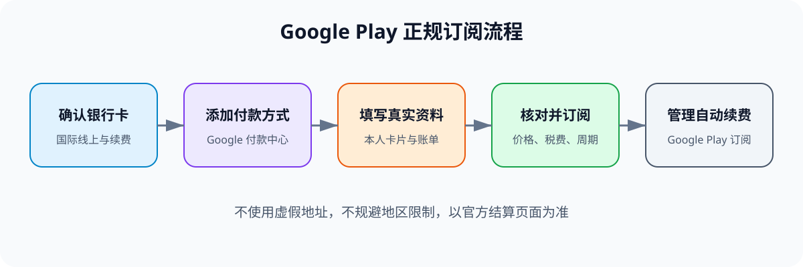
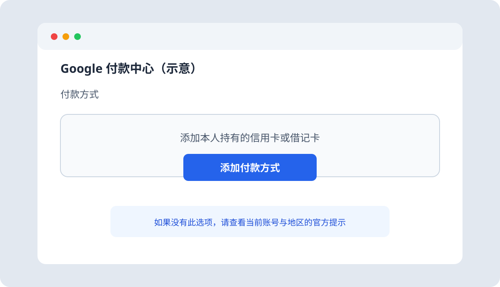
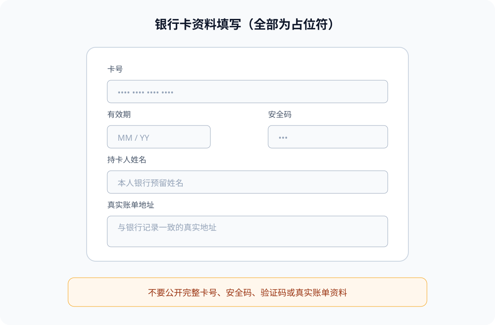
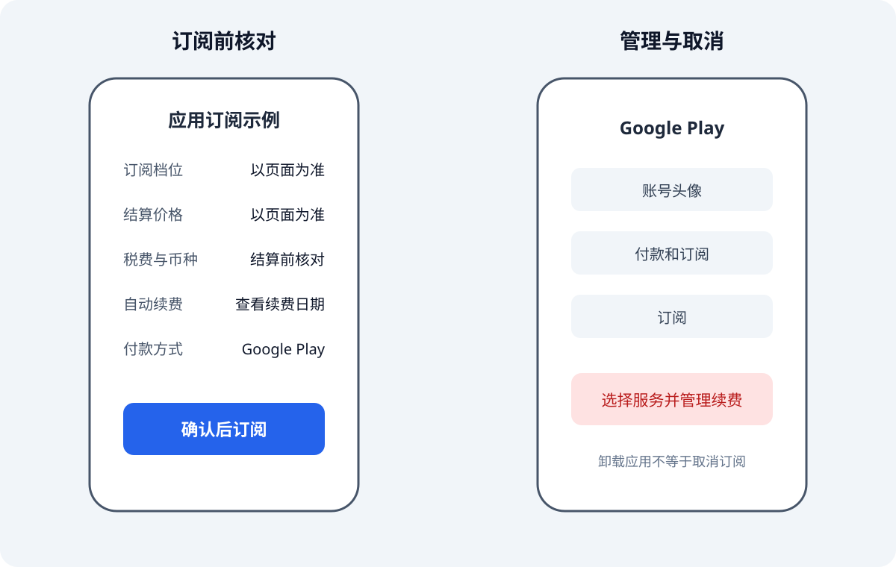

# 使用国内银行卡通过 Google Play 订阅海外应用：我的合规图文教程

我把通过 Google Play 绑定银行卡并订阅应用的流程重新整理成了这篇教程，适用于支持 Google Play 结算、且本人账号与银行卡均符合平台要求的场景。

> **重要说明**：银行卡发行地、Google 账号地区、Google Play 地区及账单资料应符合平台规则。请不要使用地址生成器、虚假账单信息或其他方式规避地区限制。实际可用的卡组织、应用、价格和支付方式，以银行与结算页面为准。

## 一、流程总览



整个流程可以概括为：

```text
确认银行卡支持国际线上及周期性扣款
→ 在 Google 付款中心添加本人银行卡
→ 填写真实持卡人及账单资料
→ 在 Google Play 确认支付方式
→ 在应用内核对价格并订阅
→ 通过 Google Play 管理或取消订阅
```

## 二、开始前需要准备

1. **本人有效银行卡**  
   确认卡片支持国际线上交易和自动续费。Visa、Mastercard 等卡组织是否可用，取决于 Google 账号地区、发卡行和具体服务；银联卡仅在结算页面明确支持时使用。

2. **符合使用条件的 Google 账号**  
   账号资料应真实，所在地区应符合目标服务的使用要求。不要为了提高成功率而伪造地区或账单资料。

3. **安卓设备与 Google Play**  
   手机登录同一个 Google 账号，并将 Google Play 商店及目标应用更新到可用的最新版本。

4. **银行预留手机号**  
   部分银行卡需要短信验证码、银行 App 确认或 3-D Secure 验证。

## 三、第一步：确认银行卡状态

在绑定之前，我会先确认以下事项：

- 卡片仍在有效期内；
- 已开通国际线上支付；
- 允许订阅类商户进行周期性扣款；
- 账户余额或信用额度充足；
- 银行预留手机号可以正常接收验证信息。

如果银行 App 提供“境外线上支付”“无卡支付”或“自动扣款”等独立开关，应根据银行说明进行设置。无法确认时，直接咨询发卡行，不要反复尝试来历不明的支付方式。

## 四、第二步：进入 Google 付款中心

在浏览器中打开 [Google 付款中心](https://pay.google.com/)，登录自己的 Google 账号。

在“付款方式”页面选择“添加付款方式”，然后选择信用卡或借记卡。



> 页面布局可能随账号地区和 Google 版本变化。如果页面没有添加银行卡的选项，通常表示当前账号或地区不支持该方式，应查看 Google 官方提示。

## 五、第三步：填写真实卡片与账单资料

按照页面要求填写：

- 卡号；
- 有效期；
- 安全码；
- 持卡人姓名；
- 与银行记录一致的真实账单地址。



我会特别注意以下几点：

- 姓名按照银行预留信息填写，需要拼音时使用本人姓名的正确拼音；
- 不填写生成器制作的地址，也不冒用他人地址；
- 卡号、安全码和短信验证码只输入到确认无误的官方页面；
- 不把完整卡片截图、验证码或银行安全信息上传到公开仓库。

绑定过程中，银行可能进行小额预授权或账户验证。预授权并不等于正式订阅费用，具体释放时间以发卡行为准。

## 六、第四步：在 Google Play 确认支付方式

在安卓手机上打开 Google Play 商店，确认当前登录的是刚才绑卡的 Google 账号。

进入账号的付款方式设置，检查银行卡是否已经同步。如果没有立即显示，可以：

1. 核对 Google Play 与浏览器中的账号是否一致；
2. 检查网络连接并稍后刷新；
3. 更新 Google Play 商店和 Google Play 服务；
4. 返回 Google 付款中心，确认卡片状态正常。

如果平台明确提示该卡在所在地区不受支持，应停止尝试并选择官方允许的其他支付方式，而不是修改虚假资料绕过限制。

## 七、第五步：在应用内订阅

打开目标应用的官方安卓版本，进入订阅或升级页面。如果该服务支持 Google Play 结算，结算页面会显示 Google Play 及可用的付款方式。

付款前需要核对：

- 应用名称与开发者是否正确；
- 订阅档位和权益；
- 结算币种、税费及总价；
- 免费试用期限及试用结束后的价格；
- 自动续费周期；
- 扣款使用的银行卡。



确认无误后再完成支付。不同应用的入口和价格可能不同，不应根据旧截图中的价格判断当前费用。

## 八、费用与汇率说明

通过 Google Play 付款不代表一定“零手续费”或“固定官方原价”。实际支出可能受到以下因素影响：

- 应用设定的订阅价格；
- 当地税费；
- Google Play 结算币种；
- 发卡行汇率；
- 货币转换费或境外交易服务费。

因此，我会以应用结算页和银行最终账单为准，不依赖过期的地区价格对比表。

## 九、如何管理或取消订阅

如果不再继续使用，应在下一个续费日期前，通过 Google Play 管理订阅：

**Google Play 商店 → 账号头像 → 付款和订阅 → 订阅**

选择对应服务，查看续费日期并按照页面提示取消。取消后保留确认页面或邮件，方便后续核对。

需要注意：

- 卸载应用通常不会自动取消订阅；
- 删除银行卡不一定等同于取消订阅；
- 已产生的费用和退款资格应以服务条款及 Google Play 的处理结果为准；
- 不同应用的取消入口可能略有差异，也可以在应用官方帮助中心查询。

## 十、常见问题

### 1. 提示银行卡被拒绝

检查卡片有效期、余额或额度、国际线上支付和周期性扣款设置。如果信息无误，联系发卡行确认是否拦截了交易。

### 2. 提示付款方式不受支持

这通常与账号地区、卡片发行地、卡组织或具体服务有关。应选择平台明确支持的方式，不要使用虚假地址或他人卡片。

### 3. Google Play 中没有显示刚绑定的卡

先确认手机与浏览器登录的是同一个账号，再检查 Google 付款中心中的卡片状态，并更新 Google Play 相关组件。

### 4. 应用内没有 Google Play 支付选项

说明该应用、账号或地区可能不支持此结算渠道。应查看应用官方说明，或在其官方页面选择其他合法支付方式。

### 5. 绑卡后出现一笔小额扣款

这可能是银行或支付平台进行的预授权验证。是否退还及到账时间由发卡行处理；如果长时间未释放，应联系银行查询。

### 6. 扣款成功但订阅权益没有生效

先检查是否登录了正确的应用账号，并保留 Google Play 订单号。随后分别联系应用客服或 Google Play 支持，不要在公开渠道发布完整订单和卡片信息。

## 十一、安全清单

- 只使用本人银行卡和真实账单资料；
- 只在确认无误的官方页面输入卡片信息；
- 不向任何人提供安全码、短信验证码或银行密码；
- 不公开完整卡号、账单地址、订单详情和账户邮箱；
- 优先通过官方应用和 Google Play 管理订阅；
- 定期检查银行账单与 Google Play 订阅列表；
- 对“保证成功”“低价跨区”“代绑代付”等宣传保持谨慎。

## 十二、总结

正规流程的核心不是“跨区”或“特殊地址”，而是：**银行卡符合要求、账号资料真实、支付方式受支持、结算信息核对清楚**。

只要平台明确支持，就可以通过 Google 付款中心绑卡，再在应用内使用 Google Play 完成订阅；如果不支持，应选择官方提供的其他方式，而不是绕过限制。

## 参考与改写说明

本文根据用户提供的本地 HTML 教程重新编写。原始材料提到的参考来源包括：

- B 站视频 `BV1AZzWBuEeJ`，UP 主：Porter科技迷；
- [原作者配套文档](https://potoh.com/posts/2026-1-22/googleplay/)。

原文中的地址生成、跨区低价比较、切换网络环境规避识别及虚拟卡推荐未纳入本文。价格与可用性以当前官方页面为准。

所有配图均为重新绘制的界面示意图，不包含真实银行卡、账单地址、邮箱或订阅信息。
