# 🪪 国内卡订阅海外服务 · 保姆级图文教程

**适用对象：**想订阅 ChatGPT Plus / Claude / Grok / Gemini / YouTube Premium 等，但只有国内 Visa、Mastercard、银联卡或虚拟U卡的人。

**核心思路一句话：**不在 AI 官网直接付款，而是把卡绑到 **Google Pay / Google Play**，让谷歌当“支付中转”，再通过 Play 渠道原价订阅——**零手续费，官方原价**。

> ⚠️ **前提准备（缺一不可）**
>
> - 稳定、干净的网络环境（最好全程同一地区 IP，不要中途频繁跳国家）
> - 一张国内**全币种 Visa / Mastercard 信用卡**（推荐招商、中行，学生可办），或银联卡，或 Bitget/Bybit 虚拟U卡
> - 一个能收验证码的手机号 + 一个新的 Gmail

## 第一步：注册谷歌账号并设置地区

1. 用网络环境注册一个新的 Gmail（老账号绑过国内信息的不建议用，容易被识别为大陆用户导致订阅页面被锁）。
2. 注册时或注册后，把账号的**国家/地区**设为目标区。想省钱选**新加坡 / 尼日利亚 / 土耳其**（订阅费便宜很多），追求省事选美国。
3. 地址信息用美国/新加坡地址生成器生成一个即可（视频里用的是 meiguodizhi.com），**先记下来，绑卡时要用**。

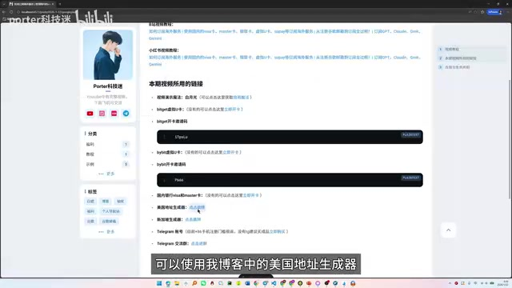

▲ 视频中演示：地址生成器里选好州/城市，复制一整套地址信息备用

## 第二步：把卡绑进 Google Pay（核心步骤）

1. 登录谷歌账号，进入 **Google 付款中心**（pay.google.com），点「添加付款方式」。

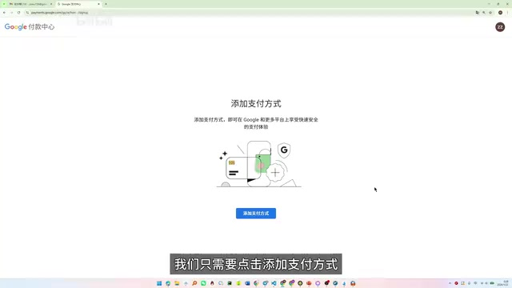

▲ Google Pay 添加付款方式入口

2. 选择「信用卡/借记卡」。地区按第一步定的选（视频演示选新加坡）。**换地区 = 换一套全新地址资料**，国家、账单地址、姓名必须互相一致。

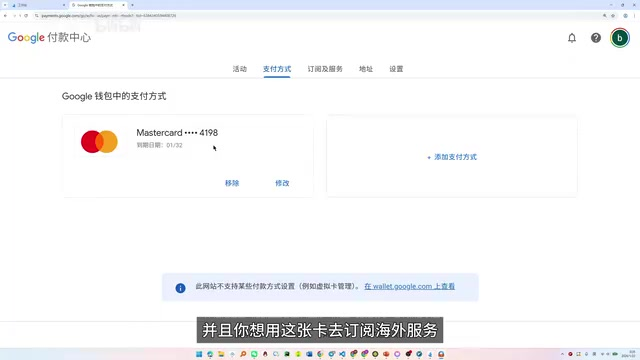

▲ Google 付款中心，已有一张 Mastercard，点「添加付款方式」继续加卡

3. 填卡号、有效期、CVC，**姓名用拼音、账单地址填第一步生成的海外地址**。

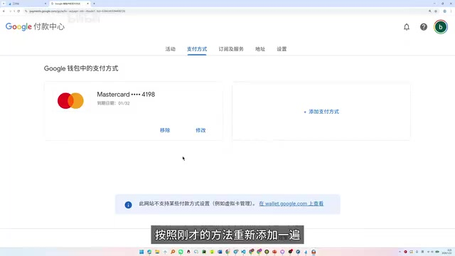

▲ 填写卡信息弹窗：卡号 + 账单地址，与地区保持一致

4. 三种卡的实际情况（视频实测）：

| 卡的类型 | 能否直绑 | 备注 |
|---|---|---|
| 国内 Visa / Mastercard 信用卡 | ✅ 最顺 | 全币种卡基本秒过，推荐 |
| 国内银联卡 | ✅ 可以 | 不用办 Visa 也能付，最省事 |
| Bitget / Bybit 虚拟U卡 | ✅ 可以 | 0开卡费0月费，适合没信用卡的；注意先入金 USDT |

5. 绑定成功后，付款中心会出现你的卡：

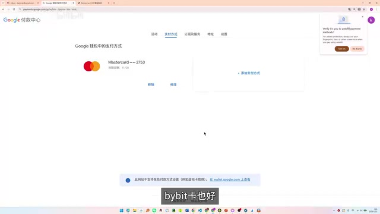

▲ 绑卡成功，Mastercard 已挂到账号上

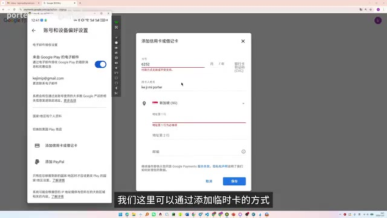

▲ 「地区和个人资料部分是空的」时，在这里补齐地区与账单地址

6. 虚拟U卡用户：把 Bitget/Bybit 后台的卡片信息直接复制粘贴过来即可。

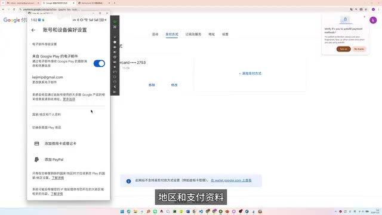

▲ 视频提示：将虚拟卡的信息复制粘贴过来即可

## 第三步：确认 Google Play 就绪（手机端）

1. 手机上登录同一个谷歌账号，打开 Play 商店 → 付款方式，确认刚绑的卡已经同步出现。

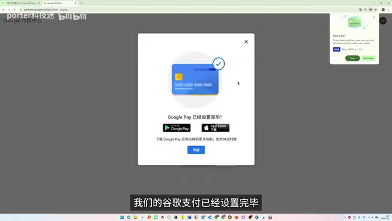

▲ 视频演示：「我们的谷歌支付已经配置完毕」

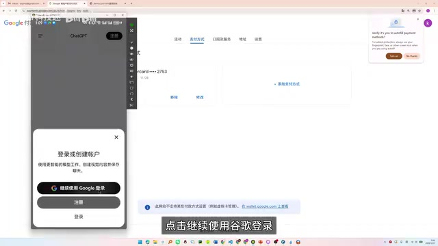

▲ 原始教程补充配图：Google Play 登录与充值入口

2. 账号地区与卡的地区不一致时，Play 会提示「无法付款/不支持」——回 Google Pay 里把地址资料改到与卡一致，或直接新加一套资料。

## 第四步：订阅海外服务（以 ChatGPT Plus 为例）

1. 在 ChatGPT App 内点升级 Plus，结算方式选 **Google Play**（谷歌代收）。

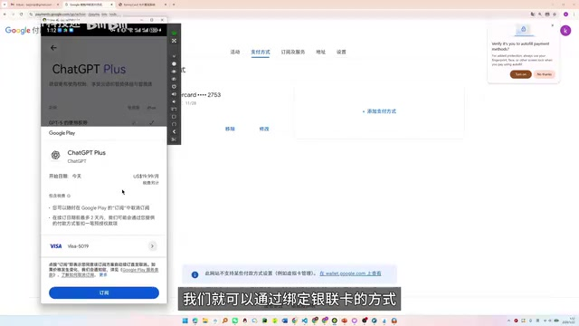

▲ ChatGPT Plus 订阅页：我们可以通过绑定银联卡的方式订阅

2. 其他服务同理：YouTube Premium、Gemini 等都可以走同一条 Play 支付通道。

▲ YouTube Premium 同样可以通过该方法去订阅

3. 免费档位参考：ChatGPT Go 这类低价/免费档也能走 Play 渠道。

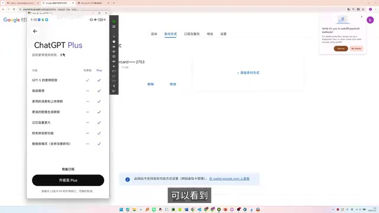

▲ ChatGPT Go 档位也可以看到并订阅

4. 付款方式里确认走刚绑的卡，确认支付，完成。之后每月自动扣款，随时可在 Google Pay 里取消。

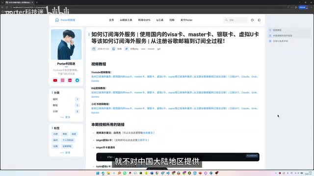

▲ 手机端显示绑定成功

## 第五步：各地区价格参考（视频 2026/01/12 数据）

同一个 Plus，不同区差价接近 **10 倍**——这就是为什么要选对地区：

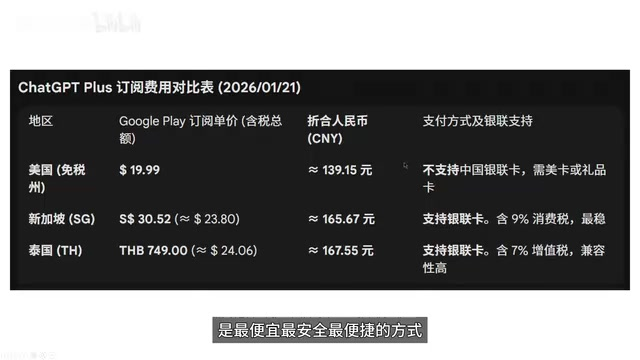

▲ ChatGPT Plus 订阅费用对比：美国 $19.99 ≈ ¥139；新加坡 S$30.32 ≈ ¥166；泰国 ฿748 ≈ ¥167（泰国含 7% 增值税，最便宜）

| 地区 | Play 订阅价（含税） | 折合人民币(CNY) | 支付方式及银联支持 |
|---|---|---|---|
| 美国（贵税） | $19.99 | ≈ ¥139.15 元 | 不支持中国大陆银联，需要卡组织品 |
| 新加坡 (SG) | S$30.32 (≈ $23.80) | ≈ ¥166.67 元 | 支持转账卡、含 9% 消费税、游客支持 |
| 泰国 (TH) | THB 748.00 (≈ $24.06) | ≈ ¥167.55 元 | 支持银联卡、含 7% 增值税、游客性质 |

## 流程总览（视频结尾的决策图）

- **是否有信用卡？** → 有：直接绑 Visa/Master → Google Pay → 订阅海外服务
- → 没有：开一张虚拟U卡（Bitget/Bybit，0开卡费）→ 注意需要新加坡地址 → Play 中绑定 → 订阅
- → 或者一步到位：注册一个银联卡（直接银联绑定 Google Play）

> ⚠️ **常见翻车点（视频与评论区高频问题）**
>
> - **提示“付款方式无法添加/不支持”**：90% 是账单地址与账号地区不一致，或 IP 刚从别的国家跳过来。换个干净 IP、地址改成与地区一致再试。
> - **绑卡后被扣预授权又退款**：正常验证流程，不影响。
> - **老 Gmail 订阅页被锁国区**：换新号重绑，别硬刚。
> - **虚拟卡被拒**：确保卡内余额充足且开卡商支持订阅类 MCC 商户。

> 📜 **合规提示**：本文整理自公开视频教程（B站 BV1AZzWBuEeJ，UP主 Porter科技迷，配套文档 potoh.com/posts/2026-1-22/googleplay/），仅供个人与朋友学习参考；请遵守所在地法律法规，虚拟U卡与地址生成等操作存在灰色地带，自担风险。

整理时间：2026-10-30 · 图片截自原视频（480P 画面，仅供自用）。
